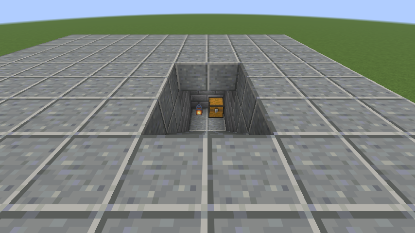
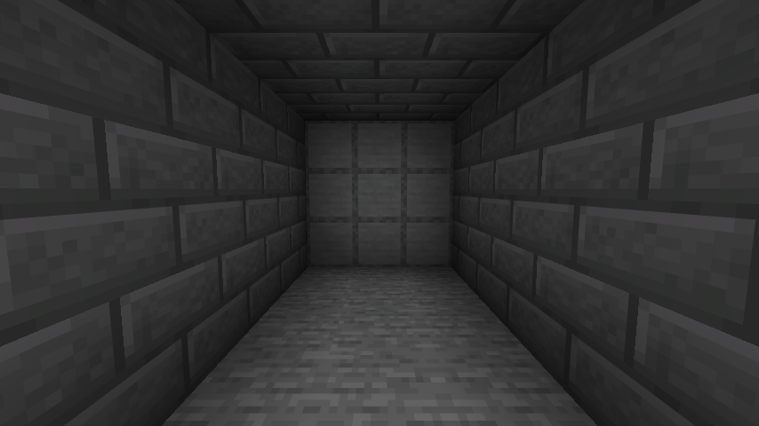
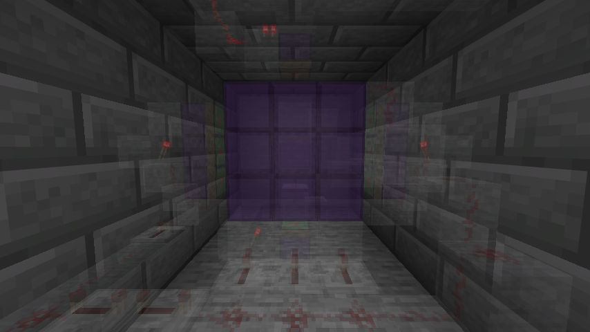
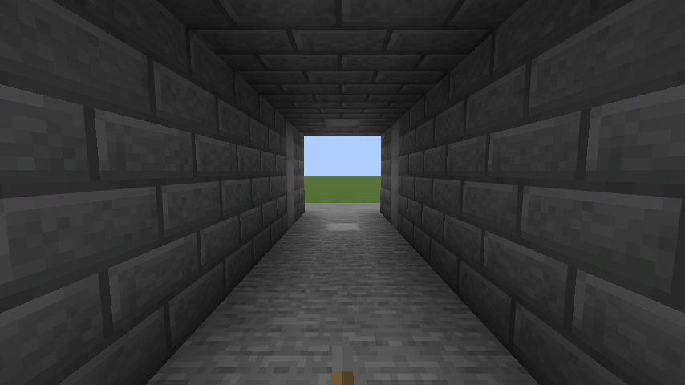
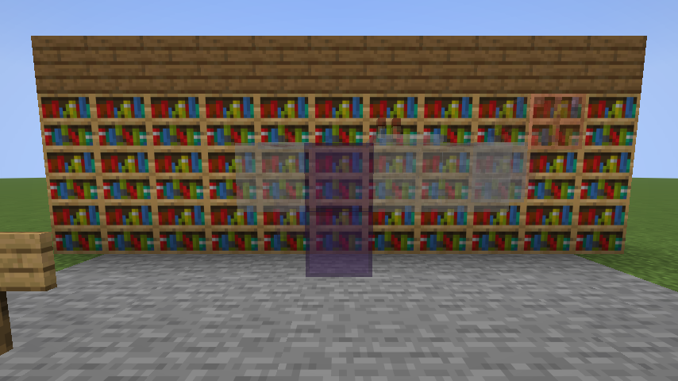
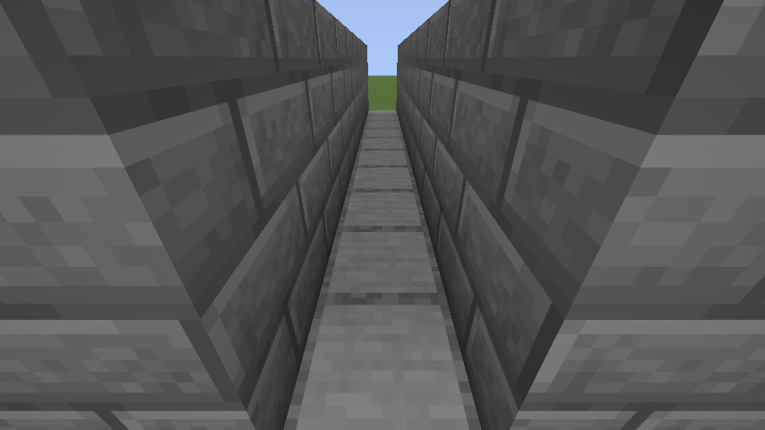
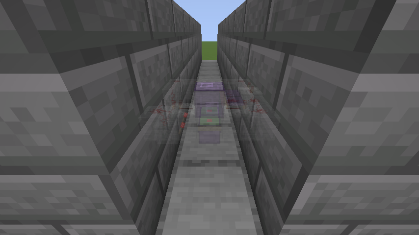

# PhaseCraft

A Minecraft Java Edition mod: a second block layer that shares the exact XYZ coordinates of the overworld, so
redstone and pistons hidden in that layer can act on the blocks of the visible world, by vanilla rules.

**Target: Minecraft Java Edition 26.3** with Fabric and Java 25. Working on the development branches: the
hidden layer (a real dimension, run by vanilla), phase ports that carry power between layers, phase pistons
that move visible blocks from the hidden layer, phase shifters that take a visible block out of the world and
put it back (and line shifters that do it for a whole row or column, block by block, with a piston's rules), a hidden 2x2 piston door, a hidden staircase (flat floor
that opens into stairs down to a cellar), a hidden 3x3 flush door, the transparent overlay (press **H** in Creative to see hidden blocks drawn as
see-through ghosts over the world; `[` and `]` change the opacity), editing mode (press **J**, and your
clicks place, use and break blocks in the hidden layer instead of the visible world) and the phase block
(a hidden button, lever, pressure plate or light standing on it reacts to the visible world: secret bricks,
secret floor tiles, and lamps hidden in walls that light the room). It all works in Survival too, with
recipes and Survival rules, and a hidden flying-machine engine can push visible blocks along (a game rule turns that off for public servers). See [Getting started](docs/GETTING_STARTED.md) and [Architecture](docs/ARCHITECTURE.md).

| Overlay off | Overlay on (H) |
| --- | --- |
|  |  |

The hidden staircase (examples station 11): one lever turns flat floor into stairs down to a cellar.

| Closed | Closed, overlay on (H) | Open |
| --- | --- | --- |
|  |  |  |

The 3x3 flush door (examples station 12), the famously hard one in vanilla: the centre block has to move twice.

| Closed | Closed, overlay on (H) | Open |
| --- | --- | --- |
|  |  |  |

A secret room behind a bookshelf wall (examples station 16): click the right bookshelf and two others slide away into the wall. There is no button or lever anywhere, only bookshelves.

| Overlay off | Overlay on (H) |
| --- | --- |
|  |  |

A trapdoor floor (examples station 17): step on the wrong tile of a plain corridor and the floor ahead drops away into a pit. The trigger is a pressure plate hidden in the floor.

| Overlay off | Overlay on (H) |
| --- | --- |
|  |  |

A flying machine with a hidden engine (examples station 15): a vanilla engine in the hidden layer carries a phase piston that pushes a visible gold block one block ahead each cycle, so the gold block flies by itself.

## Approach

- Minecraft Java Edition with Fabric (NeoForge is the other reasonable choice), Gradle and Git.
- Coding agents do most of the implementation; a person picks the features, approves milestones and playtests.
- Behaviour is proved by automated tests in a running game (Minecraft's GameTest framework), not by claims.
  No step counts as done without passing tests.

## Roadmap

1. **A working mod.** Fabric, Gradle, automated builds and GameTests. A mod that loads without errors.
2. **Overlapping block storage.** Stone in the overworld and redstone at the same XYZ in the hidden layer,
   surviving a save and reload.
3. **Layer switching.** An editing mode that switches between the real world and the hidden circuitry.
4. **Redstone across layers.** A lever in the overworld lights a redstone lamp in the hidden layer.
5. **The phase piston.** A powered piston in the hidden layer moves a block in the overworld, respecting
   vanilla piston rules.
6. **The transparent overlay.** Hidden circuitry drawn over the real world, with adjustable opacity.

The phase piston is the biggest technical uncertainty and the first major proof of concept: vanilla pistons
assume the blocks they move are in their own world. Block updates, timing, chunk loading and multiplayer
synchronisation all need investigating. Polished graphics come after it works.

## Tests to write

- A hidden-layer block and an overworld block can coexist.
- A hidden-layer piston can push an overworld block.
- A piston cannot push 13 ordinary blocks.
- Obsidian remains immovable.
- Breaking an overworld block does not destroy hidden machinery.
- All layers restore correctly after saving and restarting.

## The first instruction for the lead agent

> You are the lead developer of PhaseCraft, a Minecraft Java Edition mod.
>
> PhaseCraft enables a secondary block layer sharing the exact XYZ coordinates of the overworld. Eventually,
> redstone and pistons in this layer must manipulate overworld blocks according to vanilla Minecraft rules.
>
> Start by selecting a supported Minecraft and Fabric version, scaffolding the project, configuring automated
> builds and GameTests, and documenting the architecture.
>
> Then create a minimal proof of concept where two independently stored blocks occupy the same XYZ coordinates
> in separate layers and persist after a save/reload.
>
> Do not implement rendering overlays or phase pistons yet. Document technical risks. Run tests after each
> implementation step. Do not claim success without passing tests.
