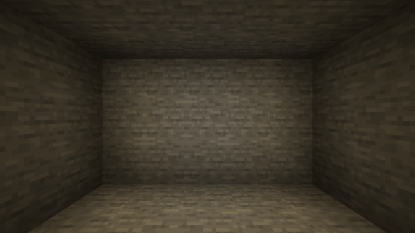

# Getting started with PhaseCraft

## Requirements
- **Minecraft Java Edition 26.3** (stable, not the 26.4 snapshot)
- Fabric Loader for 26.3 and a **Fabric API JAR for 26.3**
- Optional: **Sodium** works with PhaseCraft (tested with Sodium 0.9.3 for
  26.3, OpenGL): the overlay, editing mode, phased light and phase piston
  movement look the same as without it.
- Java Development Kit 25 (for local builds)
- Git (Gradle 9.8.2 is fetched by the committed wrapper, `./gradlew`)
- Visual Studio Code with Java and Gradle extensions, or IntelliJ IDEA

The project targets 26.3; the older 1.21.1 PhaseCraft build **will not load**
under Minecraft 26.3. Download a fresh artifact from the latest successful
GitHub Actions run and put the mod JAR (not the artifact ZIP) into the
instance's `mods` folder together with the Fabric API for 26.3.

The Gradle wrapper is committed and pins Gradle 9.8.2; use `./gradlew`
(or `gradlew.bat` on Windows) rather than a system Gradle. Only `JAVA_HOME`
pointing at a JDK 25 is needed.

## Build and run

```sh
./gradlew build
./gradlew runClient
```

The hidden layer is a real dimension at the same coordinates
(`phasecraft:hidden_overworld` for the Overworld). In a Creative world with
cheats enabled:

```text
/setblock 10 64 10 minecraft:stone
/phasecraft set 10 63 10 minecraft:stone
/phasecraft set 10 64 10 minecraft:redstone_wire
/phasecraft get 10 64 10
/phasecraft layer hidden
/phasecraft layer visible
```

The hidden layer follows vanilla rules, so the hidden wire needs a hidden
block under it (the second line); without one it breaks, as it would
anywhere. The block argument uses the same syntax as `/setblock`, with tab
completion: `redstone_wire`, `minecraft:redstone_wire` and
`minecraft:repeater[facing=east,delay=3]` all work.

`get` reports visible stone and hidden
`minecraft:redstone_wire[east=none,north=none,power=0,south=none,west=none]`.
`/phasecraft layer hidden` takes you to the same spot in the hidden layer
(Creative or Spectator only: it has no ground; switch to Survival there and
you are put back in the visible world), where you can see and build
hidden circuits with normal blocks and commands; `layer visible` brings you
back. Hidden redstone runs by vanilla rules.

To connect the layers, put a phase port in the hidden layer. It works both
ways at its spot, and nothing shows in the visible world: visible power at its
spot (a lever there or next to it) comes out of it into the hidden layer, and
hidden power reaching it comes out in the visible world at its spot, as if an
invisible redstone block stood there.

```text
/setblock 12 64 10 minecraft:lever[face=floor,powered=false]
/phasecraft set 12 63 10 minecraft:stone
/phasecraft set 12 64 10 phasecraft:phase_port
/phasecraft set 13 64 10 minecraft:redstone_lamp
```

Flip the (visible) lever and the hidden lamp next to the hidden port lights.

### Seeing the hidden layer: the overlay

In Creative, Spectator, or Survival (see "Survival play" below), hidden blocks near you (about 70 blocks around)
are drawn as see-through ghosts over the visible world: clearly where
nothing visible is in front of them, fainter through visible blocks, so
machinery inside a wall or under the floor still shows.

| Key (Controls, "PhaseCraft") | Does |
| --- | --- |
| **H** | Show or hide the overlay |
| **]** / **[** | More opaque / more see-through (15% to 100%, in steps of 10) |

The setting is kept in `config/phasecraft-client.properties`. Adventure
players, and Survival players when the game rule is off, are sent nothing,
so hidden doors stay hidden from them. The overlay needs PhaseCraft on the
client as well as on the server.

### Building in the hidden layer: editing mode

Press **J** (Creative, or Survival, see below) and "Editing: hidden layer" shows in the top left.
Your clicks now go to the hidden layer; the visible world is not touched.
What a click acts on is outlined in purple:

- **Aiming at a hidden block** (even one inside a wall, as the overlay shows
  it): right click uses it (flip a hidden lever, set a hidden repeater's
  delay) or places your block next to it; left click breaks it; middle click
  picks it into your hand (Ctrl + middle click in Creative also copies its
  contents, as vanilla does: a hidden chest with its items).
- **Aiming at a visible block with nothing hidden there:** right click puts
  your block in the hidden layer *at that same spot*, overlapping the
  visible block. That is how you hide a lamp inside a wall or a port under a
  lever. Left click does nothing.

Placing follows vanilla rules in the hidden layer, so hidden wire, repeaters
and floor levers need a hidden block under them: right click the visible
floor with stone first (it goes into the floor), then place on top of that.
Press J again to go back to normal building. The overlay is shown while you
edit, even if H turned it off. Buckets work too: a full bucket pours hidden
water or lava (at the spot you aim at, or next to the hidden block you
aim at), an empty one scoops hidden water or lava up. Fish buckets are
refused.


### Survival play

PhaseCraft works in Survival. The game rule `phasecraft:survival_access`
(on by default) lets Survival players use the overlay and editing mode, by
Survival rules:

- placing a hidden block uses up the item;
- breaking one takes its normal mining time with your tool (cracks show on
  it); it drops in the visible world, if your tool is right for it, and the
  tool wears;
- middle click selects a matching item you carry; it never makes one;
- going into the hidden layer itself stays Creative/Spectator only.

`/gamerule phasecraft:survival_access false` turns it off: on a public
server, Survival editing lets players build inside other people's walls
(claim mods only watch the visible world). Adventure players never can.

Recipes (a starting point for balancing):

| Item | Recipe |
| --- | --- |
| Phase Block x4 | an amethyst shard in the middle, redstone dust on the four sides, cobblestone in the corners |
| Phase Port | Phase Block + redstone torch |
| Phase Piston | piston + Phase Block |
| Sticky Phase Piston | Phase Piston + slime ball, or sticky piston + Phase Block |
| Phase Shifter (2) | Phase Block + ender pearl + piston |

### Secret switches: the phase block

A hidden block standing on a **phase block** (Redstone tab), or hanging on
its side, is *phased*: it reacts to the visible world at its own spot.

- **Buttons and levers:** right-click the visible block at their spot. A
  hidden button inside a brick wall, hanging on a hidden phase block behind
  it, is a secret brick: anyone can press it, in Survival too, and nothing
  shows where it is. Sneak with something in hand to place against that
  brick as usual.
- **Pressure plates:** players, mobs and items standing on their spot in the
  visible world press them. Put the hidden phase block in the floor (at the
  same spot as a visible floor block) and the hidden plate on it.
- **Light sources** (glowstone, lamps, torches, lanterns...): they light the
  visible world at their spot, by vanilla's light rules, for every player.
  A hidden lamp inside a wall, on a phase block, lights the room in front of
  it; hidden redstone switches it. A wall torch counts as hanging on the
  block behind it, a hanging lantern on the block above.
- **Observers:** a phased observer watches the visible block in front of
  it: place, break or change a block there and it pulses.
- **Comparators:** a phased comparator reads the visible block behind it: a
  chest's fill level, a cake, a composter, a full item frame behind a solid
  block, as vanilla does. It never reads visible redstone power (that is
  what phase ports are for).
- **Tripwire:** hidden tripwire hooks hanging on phase blocks, with hidden
  string between them, are tripped by players, mobs and items walking
  through the string's spots in the visible world. One hook on a phase
  block is enough.
- **Hoppers:** a phased hopper pulls from the visible world above it: a
  visible chest standing on it, or items lying on top of its spot. Hide it
  in the floor under a chest and whatever goes into the chest disappears
  into your hidden machinery.
- **Droppers and dispensers:** a phased dropper or dispenser puts out into
  the visible world in front of it: into a visible chest there, or out into
  the world (items, arrows, water, fire charges... whatever a dispenser does).
  With phased hoppers in and phased droppers out, an item sorter can take
  from visible chests and fill visible chests with none of it showing.
- They make no sound in the visible world, and neither do phase pistons:
  hidden machinery is silent there.

Not supported yet (phased, they act as ordinary hidden blocks): other
blocks, and arrows on wooden buttons. Pistons cannot move a phase block.
Examples station 13 has a secret brick and a secret plate, each lighting a
visible lamp through a hidden phase port next to its phase block; station 14 is a dark hut with a secret
brick that switches on a lamp hidden in its wall.

Station 19 has three watchers, each lighting a visible lamp: put anything in
the chest (a phased comparator reads it), walk through the narrow doorway (a
phased tripwire), or place or break a block on the chiseled brick (a phased
observer toggles a hidden copper bulb).

Station 20 is item mail: put items in the chest, then click the marked tile
in the ground a few blocks east; one item pops up out of the ground each
time (a phased hopper under the chest, hidden hoppers, a phased dropper in
the ground and a phased button under the tile).

Station 15 is a flying machine with a hidden engine: click the top of the
post and a gold block slides east by itself, pushed each cycle by a phase
piston riding on a vanilla flying-machine engine in the hidden layer
(overlay on, H, to watch the engine). Hidden obsidian stops it after eight
blocks; `python3 tools/examples.py` puts it back.

Station 16 is a secret room behind a wall of bookshelves. One of the
bookshelves facing the path is a switch (a phased button hides behind it), and
so is the one behind it on the room side: click it and two bookshelves slide
away into the wall; click either switch again and they close.


Station 17 is a trapdoor floor: walk down the raised corridor and, a few
tiles in, the floor ahead drops away into a pit (a hidden pressure plate on a
phase block is the trigger). A tunnel leads out of the pit. The floor closes
again a moment after you leave the trigger tile.

Station 18 shows the phase shifter: a plain stone-brick wall where one brick
(right of the middle) hides a lever. Click it and four bricks vanish, leaving
a doorway; click again and they come back. Behind each of those bricks a
hidden phase shifter holds the brick while it is powered. The Phase Shifter
is in the Redstone tab; crafting it (Phase Block + ender pearl + piston) makes
two. It takes what a piston could push, and chests, furnaces, barrels and
other blocks with contents too: they go with everything in them and come
back exactly as they were. If you build something in the gap meanwhile,
the returning block breaks it (it drops as an item); only an unbreakable
block like bedrock, or someone standing in the gap, makes it wait.

Station 21 is a vault: a chest built into a small wall. Click the brick
above it and the chest is gone, contents and all; click again and it is
back.

Station 22 is the giant iris door, on a raised platform (take the steps at
the front). Flip the lever beside it: a round hole opens in the middle of the
wall and grows outward, ring by ring, until the whole 7x7 doorway is open;
flip it back and it closes from the outside in. Every door block is held by
a hidden phase shifter, and all its wiring is hidden: turn the overlay on to
see how much of it there is.

Station 23 is a waterfall: five ribbons of water fall from a pool on a cliff
between rock ribs. Climb up and flip the lever on the pool's rim: the middle
ribbon stops, then the two beside it, then the outer two, each draining from
the top down, and a lit cave appears behind; flip it back and they pour again
from the outside in. A hidden phase shifter at the top of each ribbon puts a
stone back to stop it.



Save and exit your test world, reopen it, and run `/phasecraft get` again to
manually inspect persistence. The same check runs automatically as
`./gradlew restartTest` (see below).

## Current limitations

Power crosses only through **phase ports**, and visible blocks are moved
only by **phase pistons** placed in the hidden layer (all in the Redstone
tab, or `/give @s phasecraft:phase_port`, `phasecraft:sticky_phase_piston`);
see docs/ARCHITECTURE.md. Build hidden machinery with editing mode (J), with
`/phasecraft set`, or from inside the hidden layer. Hidden machinery runs
wherever the visible world around it runs. Commands require operator permission level 2. Worlds from earlier builds
are upgraded automatically at server start.

Use a **new test world**, not your personal saves: the storage format has
no migration path yet.

## Tests and the build-to-play loop

| Command | What it does |
| --- | --- |
| `./gradlew build` | Compiles, then runs **every** test below (CI runs this). |
| `./gradlew runGameTest` | In-game tests: every class named `*GameTests` in `src/gametest`. |
| `./gradlew restartTest` | Full restart: one server writes hidden cells and shuts down, a second server process loads the same world and checks them. |
| `./gradlew clientTest` | A real game client, with OpenGL, with Vulkan, and with OpenGL plus Sodium: the overlay's pictures (screenshots in `build/run/clientGameTest*/screenshots`), keys and syncing, singleplayer and on a dedicated server, and editing mode driven by real key presses and clicks. |
| `./gradlew installToMinecraft` | `build`, then (only if everything passed) replaces PhaseCraft in your Minecraft mods folder. Restart Minecraft afterwards. |

`installToMinecraft` reads your mods folder from `local.properties`
(git-ignored), for example:

```properties
minecraftModsDir=/mnt/c/Users/<you>/AppData/Roaming/.minecraft/mods
```

Reports are written to `build/reports/gametest/TEST-*.xml`. Test servers run
headless; Fabric API's GameTest mode does not read `eula.txt`. The client
tests start a dedicated server too, for which the build accepts the
Minecraft EULA (`eula = true` in build.gradle; the project owner has
accepted it). A server you run yourself (for example for RCON) needs its own
`run/eula.txt`.

Test games never contact Mojang or Microsoft: service discovery and Realms
point at local addresses, test servers run in offline mode, and test clients
skip Mojang's blocked-servers list. (Dozens of test runs once got this
network's address blocked by Mojang, which broke real logins too.)

The client tests open a game window. If `Xvfb` is installed
(`sudo apt install xvfb`) they get a private virtual display, so nothing
appears on your screen; they render in software (Mesa), which needs
`libgl1-mesa-dri libegl1 mesa-vulkan-drivers`. Without Xvfb they use your
display.

## Local dev server with RCON

For checks in a real (non-test) world, run a local dedicated server from this
project and drive it over RCON:

```sh
./gradlew runServer                      # first run creates run/; accept the EULA in run/eula.txt
python3 tools/rcon.py "phasecraft get 10 64 10"
python3 tools/rcon.py "stop"
```

`run/` is git-ignored. Set these in `run/server.properties` before the first
real start: `enable-rcon=true`, a random `rcon.password`,
`server-ip=127.0.0.1` so neither the game port nor RCON is reachable from
other machines, and `pause-when-empty-seconds=0`: by default a server with
nobody online stops ticking after 60 seconds, and then nothing crosses
between layers (crossing happens on the next tick). `/phasecraft link` shows
the cross-layer counters; `pending` that never drains means no ticks. `tools/rcon.py` reads the host, port and password from that
file. Join from the Fabric 26.3 profile at `localhost`, with the same
PhaseCraft build in your mods folder (`./gradlew installToMinecraft`;
otherwise the server refuses the join over the new blocks).

**WSL2 (Windows):** in WSL's default NAT networking, Windows' `localhost`
does not reach a server bound to 127.0.0.1 inside WSL. Set `server-ip` to
WSL's own address (`ip -4 addr show eth0`, e.g. 172.23.x.x) and join at that
address; it is only reachable from this PC, and may change after a reboot.
Alternatively switch WSL to mirrored networking. Then, to use `/phasecraft`
in game, make yourself an operator with
`python3 tools/rcon.py "op <your name>"`.

### Examples world

`python3 tools/examples.py` builds a row of example stations near spawn on
the running server (best on a flat world: `level-type=minecraft\:flat`),
then reads every hidden cell back and exits 1 if one is wrong. Each station
has a sign. Press H to see the hidden blocks, or inspect them with
`/phasecraft get <x> -60 0` (or `execute in minecraft:the_nether run ...`
for station 5). Rerunning it rebuilds the area from scratch;
`python3 tools/examples.py --signs-only` rewrites just the signs. Station 10 is
the hidden 2x2 door; station 11 is the hidden staircase, on a raised
platform at x = 76 (climb the stairs on its north side; the lever is at the
top). Station 12 is the 3x3 flush door: walk into the tunnel at x = 97 and
flip the lever on its floor. The script operates all three (lever on, open;
lever off, closed) and leaves them closed for you.

To get screenshots of every station with the overlay on and off, without a
server:

```sh
python3 tools/examples.py --print-commands > build/examples-commands.txt
PHASECRAFT_EXAMPLES_COMMANDS=$PWD/build/examples-commands.txt ./gradlew runClientGameTest
```
